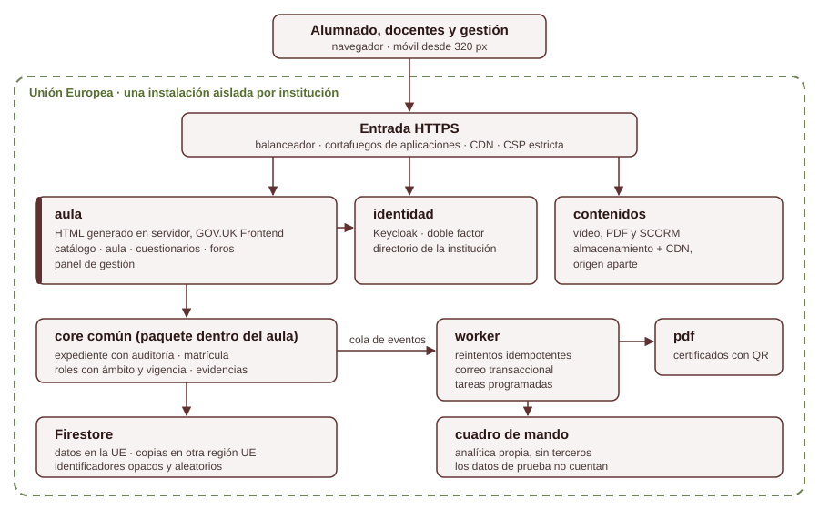

# Proportione LMS

**Un aula virtual propia, accesible y con los datos en la Unión Europea.**
*Our own learning platform: accessible, EU-hosted, tracker-free. Under construction.*

> **Estado: en construcción.** Primeras pruebas previstas a finales de 2026. Este repositorio es un escaparate: explica qué construimos y cómo, con una muestra del código. El código completo no es público.

---

## Qué es

Una plataforma de formación en línea pensada para instituciones educativas y organismos del sector público que necesitan enseñar a mucha gente sin ceder el control de sus datos ni dejar a nadie fuera por accesibilidad.

## Capacidades

| Capacidad | Qué hace | Estado |
|---|---|---|
| Catálogo e inscripción | Fichas de curso, requisitos previos e inscripción | Diseño |
| Aula | Lecciones con vídeo (subtítulos, reanudación), lector PDF y paquetes SCORM | Diseño |
| Cuestionarios | Evaluación con intentos y nota registrados en el expediente | Diseño |
| Foros moderados | Comunidad con seudónimo y moderación | Diseño |
| Certificados | Certificados en PDF verificables por código QR | Diseño |
| Panel de gestión | Autoría de cursos, cohortes, roles y carga masiva | Diseño |
| Cuadro de mando | Analítica propia, sin terceros; los datos de prueba no cuentan | Diseño |
| Base de la plataforma | Monorepo, tres servicios que arrancan y se identifican, CI obligatoria | **Construido** |
| Infraestructura | Un proyecto de nube por institución en Google Cloud (Madrid); la organización solo admite ubicaciones de la UE, comprobado intentando crear un recurso en EE. UU. | **Construido** |

## Arquitectura



- **Pocos servicios y bien separados.** `aula` sirve todo lo que ve una persona, incluido el panel de gestión. `worker` hace lo que puede reintentarse sin bloquear a nadie (correos, certificados, analítica). `pdf` genera certificados. La identidad va en Keycloak. Un servicio nuevo tiene que justificarse con una medición.
- **Un core común como paquete,** no como servicio: expediente con auditoría, matrícula, roles con ámbito y vigencia, evidencias.
- **El progreso se calcula en un solo sitio.** Cada evento de aprendizaje se escribe junto con el expediente y una cola de eventos en la misma transacción; el `worker` la consume de forma idempotente.
- **Contenidos en un origen aparte,** servidos desde almacenamiento y CDN, con su propia política de seguridad.

## Principios

**Accesible desde el diseño.** El objetivo es WCAG 2.1 AA y un uso completo desde 320 px. Los componentes salen de GOV.UK Frontend, un sistema de diseño probado con lectores de pantalla y con personas con poca destreza digital. Las páginas se generan en el servidor y solo llevan JavaScript donde hace falta.

**Los datos se quedan en la UE.** Sus proyectos de nube están en Google Cloud en Madrid y una política de la organización solo admite ubicaciones de la UE: se ha comprobado que crear un recurso en EE. UU. se rechaza. Las copias irán a otra región de la UE.

**Sin rastreadores de terceros.** El aula no lleva analítica externa ni vídeo incrustado de terceros. Lo impedirá una política de seguridad de contenidos estricta, con una prueba automática que fallará si una página carga un origen no autorizado.

**Un core para muchas instituciones.** Todas usan el mismo producto, cada una en su propio proyecto de nube, con sus datos y su perímetro de seguridad separados. Lo que cambia entre ellas (marca, textos, reglas de un programa) es configuración, nunca una versión aparte del código.

**Seguridad pensada para el sector público.** Se diseña según el Esquema Nacional de Seguridad (ENS) y el RGPD, con minimización de datos, registro de actividad inmutable y doble factor para todo el personal.

**Ingeniería verificable.** Cada criterio de aceptación se comprueba con una prueba o una medición, y lleva escrito qué lo pondría en rojo. Ninguna verja nueva se da por buena hasta haberla visto fallar.

## Bajo el capó

### Estructura del monorepo

```
apps/
  aula/        servicio web del aula
  worker/      tareas en segundo plano
  pdf/         certificados
packages/
  servicio/    arranque común de los servicios y /salud
  secretaria-core/  core común: expediente, matrícula, identificadores
infra/         OpenTofu: un proyecto de nube por institución y entorno
fixtures/      datos sintéticos, etiquetados como prueba
pruebas/       pruebas de extremo a extremo
specs/         una especificación por área, con criterios observables
```

### Un servicio que no arranca sin decir qué código sirve

Todos los servicios nacen de la misma función. Si no reciben el commit exacto que ejecutan, no arrancan: así `/salud` nunca responde «bien» sin decir qué versión está sirviendo.

```js
const FORMATO_SHA = /^[0-9a-f]{40}$/;

export function crearServicio({ nombre, sha }) {
  if (!FORMATO_SHA.test(sha ?? '')) {
    throw new Error(`${nombre}: GIT_SHA debe ser un SHA de git de 40 caracteres; recibido «${sha ?? ''}»`);
  }
  const app = express();
  app.disable('x-powered-by');
  app.get('/salud', (_req, res) => {
    res.json({ estado: 'ok', servicio: nombre, sha });
  });
  return app;
}
```

### Una CI que falla cerrada

- **Cuatro comprobaciones obligatorias en cada cambio:** pruebas unitarias con lint y tipos, integración contra el emulador de la base de datos, extremo a extremo y el plan de la infraestructura con sus reglas (residencia en la UE, ningún permiso amplio a cuentas de servicio). Sin las cuatro en verde, no se fusiona.
- **Corren en todos los cambios,** también en los que solo tocan documentación: una comprobación saltada no cuenta como aprobada.
- **Recuento de pruebas:** la CI falla si un paquete se queda sin pruebas, si desaparece uno o si el número de pruebas baja más de un 10 % frente a la última versión buena. Si no puede leer la referencia, también falla: un error nunca es un «todo bien».
- **Cada verja se ha visto en rojo:** se rompe a propósito (una mutación) para comprobar que salta, y se comprueba que no rechaza el caso bueno.
- **Dependencias fijadas,** incluidas las acciones de la CI, por su hash exacto.
- **Despliegue sin claves:** la CI se autentica en la nube por federación de identidad, y solo la rama principal puede aplicar cambios de infraestructura.

## Contacto

¿Tu institución necesita un aula virtual así? Hablemos: [proportione.com/contacto](https://proportione.com/contacto/) · info@proportione.com

---

Un proyecto de [Proportione](https://proportione.com) · Aveiro · Madrid
